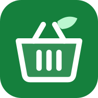
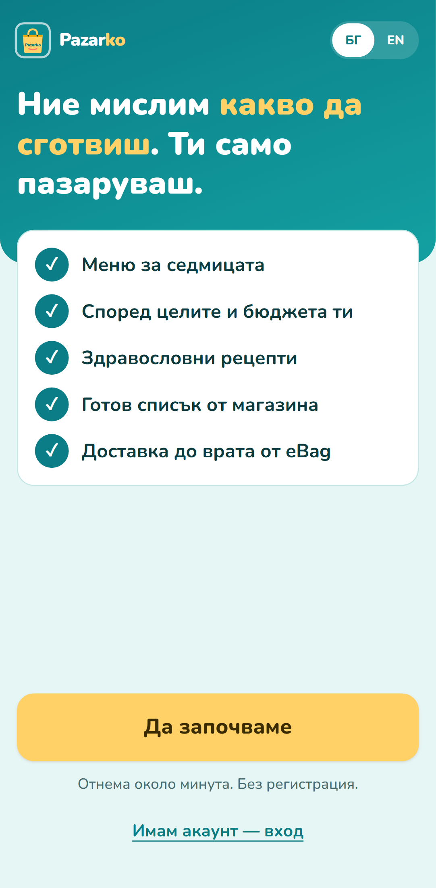
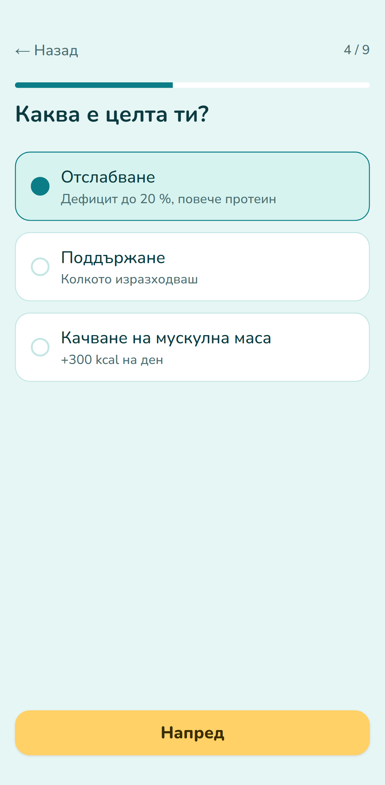
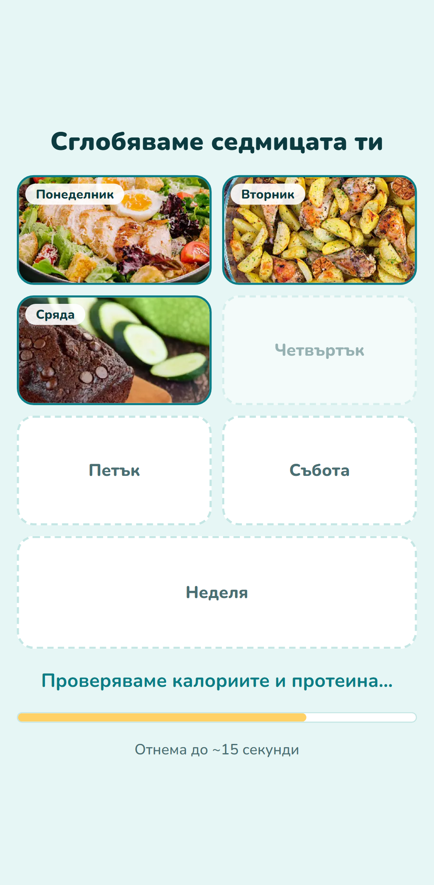
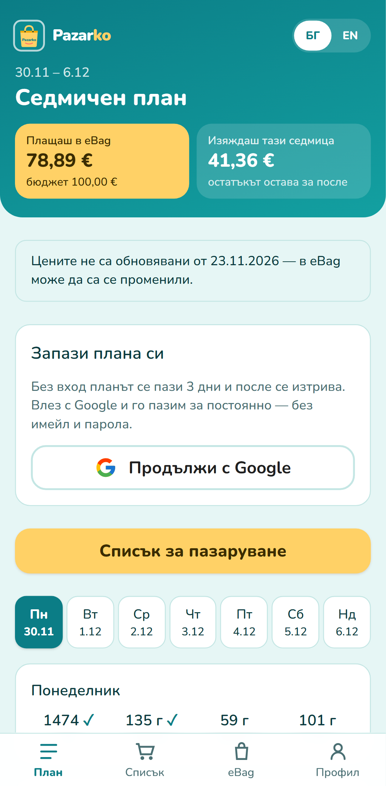
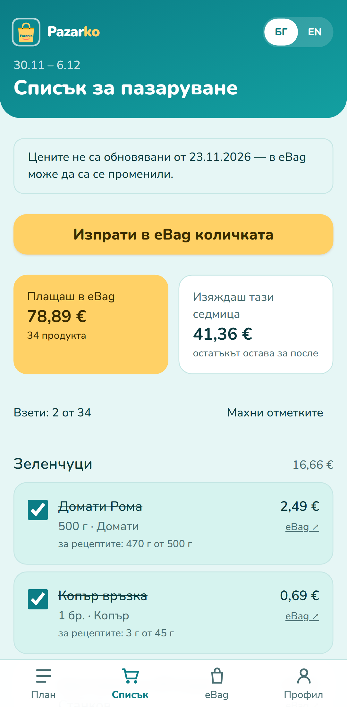
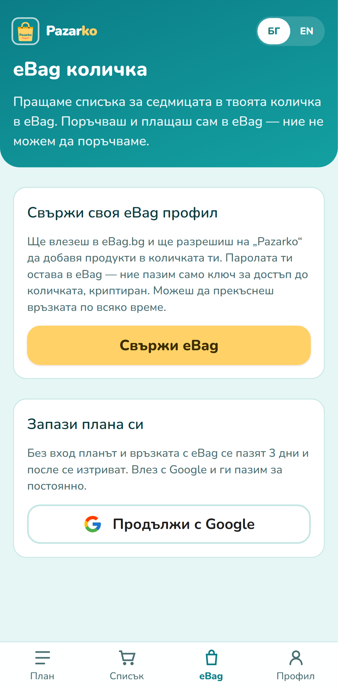
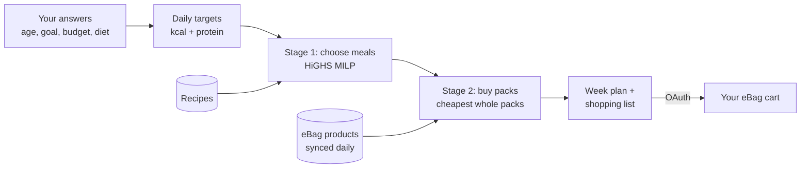

<div align="center">



# Pazarko

**A week of healthy meals that fits your goals and your budget, with the shopping list ready in your eBag cart.**

[](https://pazarko-app.vercel.app)
[](https://github.com/GGarenov/shopping_planner/actions/workflows/ci.yml)
[](https://github.com/GGarenov/shopping_planner/actions/workflows/codeql.yml)
[](https://nextjs.org)
[](https://supabase.com)
[](https://www.typescriptlang.org)

[**Open the app →**](https://pazarko-app.vercel.app) · [Development guide](docs/DEVELOPMENT.md) · [Specification](docs/SPEC.md)

</div>

---

Pazarko (from _пазар_, "market") answers the two questions behind every grocery run: **what should I eat this week,
and what do I need to buy?** You answer a few questions (age, goal, weekly budget, what you don't eat). An optimizer
then picks recipes for seven days that hit your calories and protein. It also chooses the cheapest combination of
**real products and whole packs from [eBag.bg](https://www.ebag.bg)**, at current prices. One tap sends the list to
your eBag cart, and you order and pay on eBag as usual.

It is built for Bulgaria, in Bulgarian first (English too), and simple enough for anyone. No sign-up is needed to
get a plan.

## Screenshots

<table>
  <tr>
    <td align="center" width="33%"><br /><b>Start</b><br /><sub>What the app does, one button</sub></td>
    <td align="center" width="33%"><br /><b>A few questions</b><br /><sub>Body data, goal, budget, diet</sub></td>
    <td align="center" width="33%"><br /><b>Putting your week together</b><br /><sub>About 10 seconds</sub></td>
  </tr>
  <tr>
    <td align="center"><br /><b>Your week</b><br /><sub>Cost, budget, calories and protein per day</sub></td>
    <td align="center"><br /><b>Shopping list</b><br /><sub>Real eBag products, whole packs</sub></td>
    <td align="center"><br /><b>Send to eBag</b><br /><sub>Fills your own cart; you check out on eBag</sub></td>
  </tr>
</table>

## Features

- 🥗 **7-day meal plan** that meets daily calorie and protein targets (Mifflin–St Jeor, adjusted for your goal).
- 💶 **Fits your budget.** It counts what you pay at the checkout and what you actually eat this week; leftovers
  from a pack are kept for later. If the budget is too low, the app says how much is needed.
- 🛒 **Real products, real prices.** About 1,000 eBag products, prices synced every day, nutrition from the
  product labels (USDA as a fallback).
- 📦 **Whole packs, no waste.** The optimizer buys packs, not grams, and reuses what is left across recipes.
- 🚚 **One tap to the eBag cart** through eBag's OAuth: we never see your eBag password.
- 🚫 **Diets, allergies and exclusions** (vegetarian, no pork, no fish, nuts, gluten…) and what you already have at home.
- 👤 **No account needed.** Guests get a full plan; "Continue with Google" keeps it for good. Idle guest data is
  deleted after 3 days.
- 🌍 **Bulgarian and English**, mobile first, accessible (WCAG 2.1 AA checked by automated tests).

## How it works



The planner is a two-stage **mixed-integer linear program** solved with [HiGHS](https://highs.dev) (WebAssembly) in
a serverless function. Stage 1 picks a varied week of recipes that meets the targets. Stage 2 picks which products
and how many packs to buy, sharing packs between recipes to keep the bill low. A GitHub Actions job crawls eBag
every night for prices, stock and nutrition labels.

## Tech stack

| Layer          | What                                                                                      |
| -------------- | ----------------------------------------------------------------------------------------- |
| App            | [Next.js 15](https://nextjs.org) (App Router, server actions), React 19, Tailwind CSS 4   |
| Data & auth    | [Supabase](https://supabase.com): Postgres with Row Level Security, Auth (Google, guests) |
| Optimizer      | [HiGHS](https://highs.dev) MILP solver (WASM)                                             |
| Shop           | eBag.bg via MCP + OAuth 2.1 (PKCE)                                                        |
| Languages      | [next-intl](https://next-intl.dev), Bulgarian and English                                 |
| Hosting & jobs | Vercel; GitHub Actions for CI, CodeQL and the daily eBag sync                             |
| Quality        | Vitest + Testing Library, Playwright + axe on phone viewports, RLS tests, Sentry          |

## Quick start

Needs Node ≥ 22.18 and a Supabase project.

```bash
git clone https://github.com/GGarenov/shopping_planner.git
cd shopping_planner
npm install
cp .env.example .env.local   # Supabase keys, EBAG_TOKEN_KEY, APP_BASE_URL
npm run db:push              # apply the migrations (after `npx supabase link`)
npm run seed                 # load ingredients, recipes and products
npm run dev                  # http://localhost:3000
```

`npm run check` runs what CI runs: formatting, lint, types and unit tests. See the
[development guide](docs/DEVELOPMENT.md) for tests, the eBag sync, logs and monitoring.

## Project structure

```text
app/            pages and API routes (plan, list, eBag cart, auth callback, health)
components/     shared UI
lib/            planner, eBag client, auth, i18n, logging (shared by the app and the scripts)
messages/       UI text, bg + en
data/           recipes, ingredients, eBag catalog snapshot
supabase/       database migrations and config
scripts/        data jobs: eBag sync, seeding, recipe build, icons
e2e/, test/     Playwright end-to-end and Row Level Security tests
docs/           specification, development guide, feature notes, screenshots
```

## Quality and security

- **Every user sees only their own data**: Postgres Row Level Security, proven by tests that run against a real
  database. eBag tokens are encrypted (AES-256-GCM) and readable only by the server.
- **Tested end to end**: a guest and a new user go from the first screen to a plan, the shopping list and the eBag
  screen, in Chromium (Pixel 7) and WebKit (iPhone 15). Every screen is checked with axe.
- **CI on every push**: formatting, lint, strict types, ~230 unit and component tests with coverage thresholds,
  dependency audit and CodeQL.
- **GDPR**: data is used only for the plan, with clear consent; users can delete their account and everything in it.

## Documentation

- [Development guide](docs/DEVELOPMENT.md): setup, tests, database, eBag sync, errors and monitoring
- [Specification](docs/SPEC.md): product, data model, planner and roadmap
- [Feature notes](docs/notes/): design notes for guest mode and later changes (in Bulgarian)

---

<div align="center"><sub>Made in Bulgaria 🇧🇬 · Prices and products from <a href="https://www.ebag.bg">eBag.bg</a> · Pazarko is not affiliated with eBag</sub></div>
